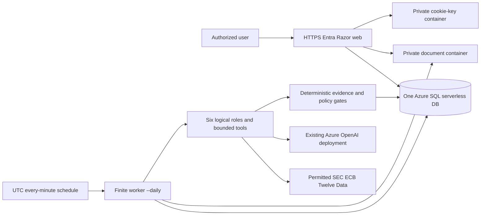

# Architecture Overview

One modular .NET 10 application. Domain owns deterministic finance/policy; Application owns import, durable run coordination and the actual six-role research loop; Infrastructure owns SQL, Blob, bounded sources and Azure OpenAI transport. Web is a thin authenticated Razor workspace; Worker is one shared finite executable with no ingress.

SQL records durable pending intent before HTTP success. Worker claims one due/expired run under SQL owner/generation/expiry fencing; staged Blob artifacts are not visible published results until the matching SQL manifest commits. No Queue, outbox service, second database, permanent dispatcher, web ARM job-start privilege or deployed runtime per analyst.

Consumption Container App HTTP `minReplicas=0`, `maxReplicas=1`; one-minute Consumption Job `* * * * *`, `--daily`, batch one, 900-second platform timeout, zero platform retries. Overlapping executions are possible; job parallelism is per execution, not a global one-worker guarantee. Runtime SQL claims handle overlap. Normal wait includes cadence, image pull, startup and SQL resume; within-minutes behavior is intended, not measured live.

GPv2 Hot/LRS Blob has private document and cookie-key containers. Web and worker receive container-scoped Blob Contributor on documents; only web receives it on keys. Basic ACR has admin credentials off, distinct MI pull grants, optional external federated deploy push grant. One Log Analytics path, 30-day default retention and a daily ingestion quota; no duplicate Application Insights sink.

Web, worker and deploy identities are separate. SQL has supplied Entra-only administrator and manually bootstrapped runtime users with table-scoped DML, not db_owner. Existing Foundry binding may target a different existing resource group in the same subscription; only worker receives scoped OpenAI User inference RBAC. New account/deployment creation, workloads and live rights default off.

Public service endpoints plus authentication are not network-private endpoints. SQL network access requires a reviewed firewall path; opting into Azure-services `0.0.0.0` permits connections from other Azure tenants at the network layer, with Entra SQL authorization still required. Private networking is not silently introduced.

Scope and verification: [requirements](../product/requirements.md), [acceptance](../product/roadmap-and-acceptance.md), [Bicep entry](../../infra/main.bicep). Source-owner issues and external verification remain distinct from locally compiled infrastructure.